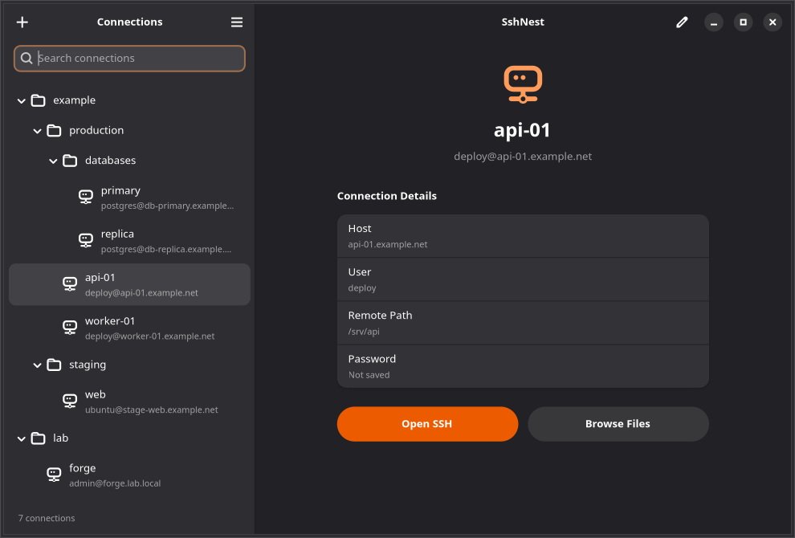

# SshNest

A small native Linux app for saved SSH and SFTP connections, written in Python
with GTK4 and libadwaita. It follows the desktop's light/dark theme and accent color.



## Features

- Nested folder tree, with expand/collapse and right-click actions
- Search by connection name, host, user, remote path, or folder
- Add, edit, rename (F2), and delete folders or connections
- Edit the selection with F4; create a connection with Ctrl+N
- Open SSH in a new Tilix window; Ctrl+Enter opens the selected connection
- Browse SFTP in Nautilus, with `gio open` and `xdg-open` fallbacks
- First-run shell-history import; additional imports require confirmation
- Responsive split view, native dialogs, and non-blocking launch checks

The existing `~/.config/sshnest/config.json` format is unchanged. Saved passwords
retain their existing behavior: used for SFTP, never inserted into SSH terminal
commands. Removing a folder asks for confirmation and also removes its nested
folders and saved connections.

## Development

Use the local `.venv`; do not install Python dependencies into the OS Python.
GTK4 (4.12+) and libadwaita (1.5+) are native system libraries. On Ubuntu 26.04,
install the native runtime and build prerequisites:

```bash
sudo apt install libgirepository-2.0-dev libcairo2-dev pkg-config python3-dev \
  gir1.2-gtk-4.0 gir1.2-adw-1
./scripts/dev_setup.sh
./scripts/run.sh
```

To preview sample connections without touching your own configuration or shell
history, use an isolated configuration directory:

```bash
mkdir -p build/demo-config/sshnest
cp samples/screenshot_config.json build/demo-config/sshnest/config.json
XDG_CONFIG_HOME="$PWD/build/demo-config" ./scripts/run.sh
```

## Verification

```bash
.venv/bin/python -m compileall -q src tests
PYTHONPATH=src .venv/bin/python -m unittest discover -s tests -v
```

GUI tests require a display and use temporary sample configuration, never your
saved connections. For a headless machine, install `xvfb` and run:

```bash
xvfb-run -a env GDK_BACKEND=x11 GSK_RENDERER=cairo GSETTINGS_BACKEND=memory \
  PYTHONPATH=src .venv/bin/python -m unittest discover -s tests -v
```

## Build

```bash
./scripts/build_appimage.sh
```

This builds `dist/SshNest/SshNest` using the maintained GTK PyInstaller spec,
then packages it as `SshNest-x86_64.AppImage`. The AppImage bundles Python,
PyGObject, GTK4, libadwaita, and their introspection data; Qt is no longer used.
Build on the oldest supported distribution. A build made on Ubuntu 26.04 targets
Ubuntu 26.04 or a compatible newer system; it is not guaranteed to run on older
Linux distributions.

External system commands are still expected: `ssh`, preferably `tilix`, and
`nautilus`, `gio`, or `xdg-open` for SFTP. They run with the host library paths,
not the AppImage's bundled GTK environment. No real SSH/SFTP sessions are opened
by the automated tests.
